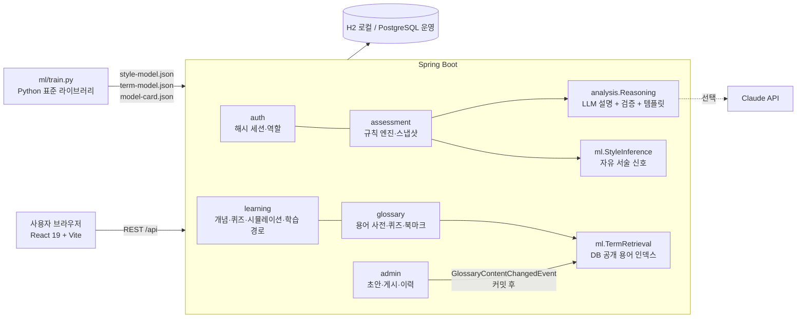

# FinMATE

**투자 성향 진단과 금융 학습을 잇는 웹 서비스.** 투자 성향을 규칙으로 진단하고 그 근거를 남기며, 등급과 상관없이 주식 용어·상품 구조를 배우고, 가정한 숫자로 직접 실험해 보게 합니다. 특정 상품의 매수·매도를 권하지 않습니다.

> "무엇을 사야 하나?"가 아니라 "무엇이 바뀌면 결과가 달라지고, 그것을 어디서 확인하나?"에 답하는 서비스

| | |
|---|---|
| 진단 | 5개 문항 → 규칙 엔진이 0~100점·5단계 성향·탐색 카테고리를 결정, 진단 당시 근거를 불변 스냅샷으로 기록 |
| 학습 | 주식 용어 247개(14개 분류) · 개념 트리 59개 · 개념별 확인 문제 75개 · 메커니즘 시뮬레이션 11개 · 포트폴리오 실험 |
| AI | 직접 학습한 모델 2개(자유 서술 성향 신호, 질문형 용어 검색) + LLM 설명(실패 시 템플릿) — **등급은 바꾸지 않음** |
| 개인화 | 진단 결과·직접 쓴 생각·오답 기록으로 다음에 볼 개념·용어를 사유와 함께 안내, 1·3·7·14·30일 간격 복습 |
| 운영 | 용어 초안 → 검증 → 게시, 공개 내리기, 불변 게시 이력, 게시 즉시 검색 반영 |

---

## 왜 만들었나

금융을 처음 시작하는 사람은 세 군데서 막힙니다.

1. **진단 결과를 믿기 어렵다.** 성향 등급은 나오지만 "왜" 그런지, 다음 달에도 같은 근거로 설명되는지 알 수 없습니다.
2. **등급이 학습을 막는다.** 안정형으로 분류되면 위험한 상품은 볼 수조차 없는 구조가 많습니다. 하지만 위험한 상품일수록 구조를 먼저 이해해야 합니다.
3. **용어에서 멈춘다.** PER·배당락·반대매매를 검색하면 광고와 커뮤니티 글이 섞여 나오고, 이름을 모르면 검색조차 할 수 없습니다.

FinMATE는 이 세 가지를 하나의 흐름(진단 → 근거 → 용어·개념 → 실험 → 복습)으로 잇습니다. 요구사항과 근거는 [UR 분석](docs/16-user-requirements-analysis.md)에, 사용자 흐름은 [시나리오](docs/17-user-scenarios.md)에 정리했습니다.

## 이 프로젝트의 의의

**1. 판정과 학습을 분리한 금융 교육 설계**
투자 성향 등급(거래 안내의 근거)과 학습 접근(지식)을 같은 문으로 묶지 않았습니다. 진단·이력만 로그인을 요구하고, 개념·용어·모의투자·모델 실험은 누구에게나 열려 있습니다. "이 상품을 살 수 있는가"는 금융회사의 몫으로 두고, "이 상품이 왜 위험한가"는 누구나 배울 수 있게 했습니다.

**2. AI에게 맡길 일과 맡기지 않을 일을 명확히 나눈 구조**
점수·등급·카테고리는 결정적인 규칙 엔진이 정하고, AI는 그 뒤에 설명하거나 보조 신호를 냅니다. 자유 서술이 공격적이어도 등급은 설문 결과 그대로이며, 차이가 크면 "답변을 다시 확인해 보세요"라는 플래그만 붙습니다. 금융 결과의 재현성과 통제 가능성을 지키면서 AI를 유용하게 쓰는 방법을 코드와 테스트로 보여 줍니다.

**3. 직접 학습하고, 한계까지 공개한 모델**
외부 API에 기대지 않고 두 모델을 Python 표준 라이브러리로 학습했습니다. 학습에 쓰지 않은 사람이 쓴 문장으로 평가하고, 기준선(키워드 규칙·이전 모델) 대비 성능과 알려진 한계를 모델 카드로 화면에 공개합니다. 근거가 부족하거나 주제와 무관한 문장은 추측하지 않고 판단을 보류합니다.

**4. 개인정보 최소화와 감사 가능성**
진단의 자유 서술 원문은 저장하지 않고 모델 추정 결과만 남깁니다. 로그인 토큰은 해시로만 저장하고, 용어 공개 상태가 바뀔 때마다 누가·언제·어떤 내용을 공개했는지 불변 기록을 남깁니다. 진단 당시의 문항 해시·규칙 버전·모델 버전을 스냅샷으로 보존해 나중에도 같은 근거로 설명할 수 있습니다.

**5. 끊김 없는 추적성**
사용자 요구(UR) → 기능 요구(FR) → 화면 → API → 데이터 → 테스트가 문서와 코드에서 이어집니다. 학습(Python)과 추론(Java)이 같은 결과를 내는지 문장 하나하나 비교하는 테스트, 출처 없는 콘텐츠나 깨진 링크가 있으면 아예 기동하지 않는 검증이 그 예입니다.

---

## 화면 구성

| 경로 | 화면 | 로그인 |
|---|---|---|
| `/` | 첫 화면 — 서비스 흐름, 실제 용어 수·모델 지표, 하는 일/하지 않는 일 | 불필요 |
| `/glossary`, `/glossary/:slug` | 주식 용어 사전 — 분류·난이도 필터, 글자 검색 + 질문 의미 검색, 용어 퀴즈, 저장 | 불필요(저장은 필요) |
| `/learn` | 개념 트리·학습 카드·확인 문제·시뮬레이션·AI 설명 (`?concept=slug`로 바로 열기) | 불필요(기록은 필요) |
| `/practice` | 교육용 포트폴리오 실험·충격 전후 비교 | 불필요 |
| `/models` | 모델 실험실 — 자유 서술 신호·질문형 검색 체험, 모델 카드 | 불필요 |
| `/start` → `/diagnosis` → `/result/:id` | 월 1회 성향 진단(마지막 단계 선택형 자유 서술) → 결과·근거·신호 | 필요 |
| `/explore/:id`, `/product/:id` | 탐색 카테고리·예시 상품 | 필요 |
| `/history` | 진단 이력·답변 변화 비교 | 필요 |
| `/me` | 내 학습 — 개인화 학습 경로, 복습 일정, 오답노트, 풀이 기록 | 필요 |
| `/admin/glossary` | 콘텐츠 운영 — 현황, 새 용어, 초안·게시·공개 내리기, 이력 | 관리자 |

## 아키텍처



| 계층 | 기술 |
|---|---|
| 프런트엔드 | React 19, TypeScript, React Router 7, Vite 8 (외부 UI·차트 라이브러리 없이 CSS·SVG로 구현) |
| 백엔드 | Spring Boot 3.3, Java 21, Spring Data JPA, Bean Validation, BCrypt |
| 데이터 | H2(로컬·테스트), PostgreSQL 16(운영 프로필), 콘텐츠는 버전이 있는 JSON 시드 |
| AI | 자체 학습 모델 2개(Python 표준 라이브러리 학습 → Java 추론), Anthropic Java SDK(설명 생성, 선택) |
| 배포 | Docker, docker-compose(PostgreSQL), Render 블루프린트, Netlify(프런트) |

## AI와 학습 모델

| 모델 | 하는 일 | 핵심 지표(학습에 쓰지 않은 평가 데이터) | 기준선 |
|---|---|---|---|
| **자유 서술 성향 신호** v2.0.0 | 투자 생각 문장 → 5단계 성향 확률 + 관심사 태그 9종, 설문과 2단계 이상 다르면 확인 플래그 | 보류 115문장 정확도 **0.617**, ±1등급 **0.904**, 주제 무관 문장 보류 **100%** | 키워드 규칙 0.417, 이전 모델 0.522 |
| **질문형 용어 검색** v2.0.0 | 용어명을 몰라도 설명형 질문으로 관련 용어 검색 | test 86질문 Top-1 **0.860**, Top-5 **0.988**, 설명형 Top-1 **0.792** | 이전 방식 설명형 Top-1 0.415 |

- **학습 데이터**: 설문 축(목적·손실 반응·기간·경험·여력) 문장 조각으로 만든 라벨 균형 문장 1,500개 + 사람이 쓴 개발 문장 40개. 평가 문장은 생성기와 따로 사람이 썼고, 학습 재료와의 유사도를 테스트로 감시합니다.
- **재현**: `make model` 한 번으로 학습·평가·내보내기(약 20초, seed 고정). 외부 패키지·네트워크·개인 데이터가 필요 없습니다.
- **일치 보장**: Java 추론이 Python 결과와 문장·질문마다 같은지 `MlParityTest`가 검사합니다.
- **개인정보**: 진단의 자유 서술 원문은 저장하지 않습니다.

자세한 내용: [ml/README.md](ml/README.md)(재현·지표), [docs/18](docs/18-ai-models-and-data-governance.md)(설계·거버넌스), 화면 `/models`(모델 카드).

---

## 시작하기

### 준비물

- Java 21, Maven 3.9+
- Node.js 20+ 와 npm
- Python 3.10+ (모델 재학습·테스트 시에만)

### 로컬 실행

```bash
cp backend/.env.example backend/.env
```

```bash
make dev
```

- 프런트 http://localhost:5173 · 백엔드 http://localhost:8080/api · H2 콘솔 http://localhost:8080/api/h2-console
- 포트가 사용 중이면 `make dev BACKEND_PORT=8180 FRONTEND_PORT=5180`
- 로컬 DB는 메모리 H2라 재시작하면 가입·진단 기록이 초기화됩니다. 진단 문항·상품·용어는 기동 시 자동으로 적재됩니다.
- `backend/.env`의 `FINMATE_ADMIN_EMAIL`·`FINMATE_ADMIN_PASSWORD`(12자 이상)로 관리자 계정이 만들어집니다. 공개 가입으로는 관리자가 될 수 없습니다.
- `ANTHROPIC_API_KEY`를 넣으면 진단 근거·개념 설명을 Claude가 생성하고, 비워 두면 규칙 기반 템플릿으로 동작합니다.

### PostgreSQL로 실행 (운영 프로필)

```bash
make docker-up
```

```bash
make docker-seed
```

용어 사전·관리자 계정은 기동 시 자동으로 만들어지고, 진단 문항·예시 상품은 `make docker-seed`로 처음 한 번만 넣습니다.

### 테스트

```bash
make test
```

| 단계 | 내용 | 개수 |
|---|---|---:|
| Python | 데이터 분리·누수, 생성기 결정성, 기준선 대비 성능, 내보낸 모델의 정답 재현 | 11 |
| Java | 규칙 엔진, 시뮬레이션 불변식, 퀴즈 채점, 세션·권한, 용어 적재, 관리자 운영 흐름, 자유 서술·학습 경로 통합, Python↔Java 일치 | 64 |
| 프런트 | TypeScript 타입 검사 + 프로덕션 빌드 | — |

### 모델 재학습

```bash
make model
```

용어 JSON을 고치면 `term-model.json`의 원천 해시가 달라져 Python 테스트가 재학습을 요구합니다. 관리자 화면에서 게시한 용어는 재학습 없이 바로 검색됩니다.

---

## 프로젝트 구조

```
FinMATE/
├── backend/                         Spring Boot API
│   ├── src/main/java/com/finmate/
│   │   ├── auth/ user/              해시 세션, 역할, 관리자 초기 계정
│   │   ├── diagnosis/ assessment/   문항, 진단 제출·스냅샷·월 1회 정책
│   │   ├── analysis/                규칙 엔진, LLM 설명·검증·템플릿
│   │   ├── learning/                개념 트리, 퀴즈, 시뮬레이션, 진도·복습, 학습 경로
│   │   ├── glossary/                용어 사전, 용어 퀴즈, 북마크, 시드 적재
│   │   ├── ml/                      자유 서술 신호·질문형 검색 추론, 모델 카드
│   │   ├── admin/                   용어 초안·게시·공개 내리기·이력, 운영 현황
│   │   └── practice/ product/       포트폴리오 실험, 카테고리·예시 상품
│   └── src/main/resources/
│       ├── glossary/                categories.json + terms/01~14-*.json (247개)
│       ├── learning/                concepts.json(59개 개념), signal-paths.json(신호→학습 규칙)
│       └── ml/                      style-model.json, term-model.json, model-card.json
├── frontend/                        React + Vite
├── ml/                              모델 학습 파이프라인 (Python 표준 라이브러리)
│   ├── train.py, finmate_ml/        생성기·학습·검색·지표
│   ├── data/                        조각 라이브러리, 개발·보류·주제 무관 문장, 검색 질문
│   └── reports/                     evaluation.json, 생성 문장 예시
├── docs/                            기획·설계 문서 (00~18, ADR, 변경 이력)
├── deliverables/                    OAS(API 2.0.0, 50 paths), DBML(최종 36 tables)
└── presentation/                    발표 자료·와이어프레임
```

## API와 데이터 모델

- API 명세: [deliverables/FinMATE-API.yml](deliverables/FinMATE-API.yml) (OpenAPI 3.0.3, 50 paths) · 요약 [docs/04](docs/04-api-design.md)
- 데이터 모델: [deliverables/FinMATE-DataModel-Final.dbml](deliverables/FinMATE-DataModel-Final.dbml) (dbdiagram.io에 붙여 넣으면 ERD) · 요약 [docs/03](docs/03-data-model.md)

## 문서 지도

| 문서 | 내용 |
|---|---|
| [00 프로젝트 개요](docs/00-project-brief.md) · [01 요구사항](docs/01-requirements.md) · [02 사용자 흐름](docs/02-user-flow.md) | 1차(MVP) 기준 문서 |
| [03 데이터 모델](docs/03-data-model.md) · [04 API 설계](docs/04-api-design.md) | 스키마·API 계약 |
| [05 설계 결정(ADR-001~018)](docs/05-decisions.md) | 왜 이렇게 만들었는가 |
| [09 재진단 정책](docs/09-product-learning-and-reassessment.md) · [10 데이터 플랫폼](docs/10-data-platform-and-learning-expansion.md) · [11 개념·퀴즈·시뮬레이션](docs/11-learning-tree-quiz-simulation.md) | 1차 고도화 설계 |
| [12 제품 전략](docs/12-product-strategy-and-user-journeys.md) · [13 FR/NFR/유스케이스](docs/13-functional-nonfunctional-usecases.md) | 제품 방향과 요구사항 전체 |
| [14 AI 서비스 연결](docs/14-ai-service-integration.md) · [18 AI·모델·데이터 거버넌스](docs/18-ai-models-and-data-governance.md) | AI 설계 |
| [16 사용자 요구사항(UR) 분석](docs/16-user-requirements-analysis.md) | UR·우선순위·추적·갭 분석·검증 계획 |
| [17 사용자 시나리오](docs/17-user-scenarios.md) | 10개 시나리오, 대안·예외 흐름, 5분 시연 스크립트 |
| [변경 이력](docs/changelog.md) | 날짜별 변경 |

## 한계와 다음 단계

- **실데이터 미연동**: 시세·공시는 데이터 이용 계약이 필요해 공급자 경계와 스키마만 설계했습니다(FR-16·17). 모의투자 숫자는 모두 가정값입니다.
- **모델 평가의 한계**: 성향 모델은 생성 문장 위주로 학습했고, 평가 문장은 한 사람이 썼습니다. 동의 기반 실제 문장으로 재평가하기 전까지 보조 신호로만 씁니다.
- **사용성 검증 미실시**: 5~8명 과업 기반 테스트 계획은 [docs/16 §9](docs/16-user-requirements-analysis.md#9-검증-계획-실사용자-대상-미실시)에 있습니다.
- **운영 범위**: 관리자 콘솔은 용어 사전을 다룹니다. 개념·문항·상품 콘텐츠 운영은 다음 단계입니다.

## 면책

FinMATE는 교육용 학습 서비스입니다. 투자 자문·투자 권유를 제공하지 않으며, 성향 진단과 카테고리 위험등급은 과제용 내부 탐색 기준으로 금융회사의 적합성·적정성 판단을 대신하지 않습니다. 세율·제도·한도는 바뀔 수 있으므로 각 용어의 출처에서 최신 정보를 확인하세요. 실제 투자 판단은 상품설명서와 공식 자료를 확인한 뒤 투자자 본인이 내려야 합니다.
