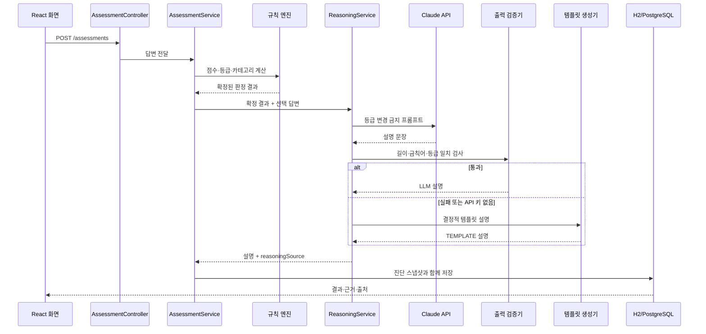
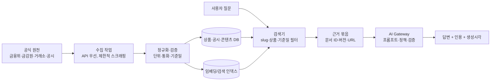

# FinMATE AI Service 연결 설계

이 문서는 FinMATE의 규칙 엔진, 학습 콘텐츠, 외부 AI 모델을 실제 서비스 경계로 연결하는 방법을 설명한다. 핵심 원칙은 **판정·계산은 서버의 결정적 코드가 소유하고, AI는 근거를 자연어로 설명하는 역할만 맡는다**는 것이다.

## 1. 현재 연결된 경로

진단 제출은 다음 순서로 실행된다.



현재 코드의 책임은 다음과 같다.

| 책임                     | 구현 위치                                                  | AI가 바꿀 수 있는가       |
| ------------------------ | ---------------------------------------------------------- | ------------------------- |
| 질문·선택지와 배점      | `diagnosis/*`                                            | 아니오                    |
| 총점·5단계 성향 등급    | `analysis/ProfileClassifier`                             | 아니오                    |
| 카테고리 적합도·순위    | `analysis/SuitabilityMatcher`                            | 아니오                    |
| 성향 판정 근거 문장      | `analysis/ReasoningService`                              | 문장만 생성               |
| 잘못된 출력 차단         | `analysis/ReasoningValidator`                            | 아니오                    |
| 개념 설명 질문 응답      | `learning/LearningAiService`                             | 승인 콘텐츠 범위 안에서만 |
| 숫자 계산·모의투자 결과 | `practice/PracticeEngine`, `learning/SimulationEngine` | 아니오                    |

## 2. 이번에 추가한 학습 AI 경로

학습 화면의 “AI에게 이 개념 다시 묻기”는 다음 API를 호출한다.

```http
POST /api/learning/concepts/{slug}/explain
Content-Type: application/json

{"question":"금리가 오르면 왜 채권 가격이 떨어지나요?"}
```

응답 예시는 다음과 같다.

```json
{
  "slug": "bond-duration",
  "title": "듀레이션",
  "answer": "듀레이션은 ...",
  "source": "CLAUDE",
  "sourceName": "금융감독원 금융교육",
  "sourceUrl": "https://...",
  "contentVersion": "2026-09-01",
  "notice": "AI 설명은 승인된 학습 콘텐츠를 바탕으로 한 교육용 안내입니다..."
}
```

`source`가 `CLAUDE`이면 외부 모델의 검증된 답변이고, `TEMPLATE`이면 API 키가 없거나 타임아웃·출력 검증 실패로 기본 설명을 사용한 것이다. 두 경우 모두 `sourceName`, `sourceUrl`, `contentVersion`을 같이 반환해 사용자가 어떤 콘텐츠를 기반으로 읽었는지 확인할 수 있다.

구현 파일:

- [LearningAiService.java](../backend/src/main/java/com/finmate/learning/LearningAiService.java): 질문 길이 제한, 원문 조합, 생성기 선택, 금칙어 검사, 템플릿 대체
- [ClaudeLearningTutor.java](../backend/src/main/java/com/finmate/learning/ClaudeLearningTutor.java): Anthropic Messages API 호출
- [LearningController.java](../backend/src/main/java/com/finmate/learning/LearningController.java): 학습 설명 API
- [LearnPage.tsx](../frontend/src/pages/LearnPage.tsx): 질문 입력과 답변·출처 표시

## 3. 실행 환경 연결

로컬에서 실제 Claude 호출을 켜려면 백엔드 실행 환경에 `ANTHROPIC_API_KEY`를 주입한다. 키가 없으면 앱은 정상 기동하며 템플릿 경로로 동작한다.

```bash
export ANTHROPIC_API_KEY="발급받은-키"
export VITE_API_BASE_URL="http://localhost:8080/api"
```

모델과 제한값은 [application.yml](../backend/src/main/resources/application.yml)에서 관리한다.

```yaml
anthropic:
  api-key: ${ANTHROPIC_API_KEY:}
finmate:
  analysis:
    claude:
      model: claude-opus-5
      max-tokens: 4096
      timeout-seconds: 30
  learning:
    ai:
      max-tokens: 1200
```

브라우저에 API 키를 넣으면 안 된다. 키는 백엔드 환경변수 또는 Secret Manager에만 두고, 프론트는 FinMATE API만 호출한다.

## 4. 실데이터와 AI를 결합하는 목표 구조

상품 가격이나 공시를 AI에게 직접 검색시키는 방식은 재현성과 출처 관리가 어렵다. 운영 단계에서는 먼저 공식 원천을 수집하고, 정제된 스냅샷을 저장한 다음, 그 범위 안에서만 AI가 답하도록 한다.



수집 방식은 다음 순서로 선택한다.

1. 제공 기관의 공식 API가 있으면 API를 1순위로 사용한다.
2. API가 없는 공개 문서만 허용 범위와 이용약관을 확인한 뒤 서버 작업에서 제한적으로 수집한다.
3. 브라우저 요청마다 크롤링하지 말고, 스케줄 작업이 수집한 결과를 DB에 저장한다.
4. 각 레코드에 `source`, `source_url`, `observed_at`, `effective_date`, `content_hash`, `revision`을 남긴다.
5. 답변 요청에는 최신값 하나만 넣지 말고 기준일과 이전 스냅샷을 함께 넣어 “현재/과거 자료” 탭을 재현한다.

## 5. AI Gateway로 고도화할 서비스 경계

현재는 사용 사례별 생성기가 분리되어 있다. 운영 규모가 커지면 아래 공통 게이트웨이를 둔다.

```text
AiGateway
 ├─ explainAssessment(resultSnapshot, answers)
 ├─ explainConcept(conceptRevision, question)
 ├─ explainProduct(productSnapshot, question)
 └─ interpretSimulation(simulationResult, scenario)
```

모든 메서드는 다음 공통 규칙을 따른다.

- 입력에는 사용자 질문과 함께 `contentVersion` 또는 `dataAsOf`를 넣는다.
- 검색 결과에는 문서 ID·출처 URL·기준일을 붙인다.
- 모델 출력은 `answer`, `citations[]`, `limitations[]` 구조로 받는다.
- 점수·순위·수익률·시뮬레이션 숫자는 원본 서버 결과를 그대로 표시하고 AI가 재계산하지 않는다.
- 모델 오류, 초과 지연, 금칙어 검출 시 템플릿 또는 원문으로 즉시 대체한다.

권장 운영 응답 형태:

```json
{
  "answer":"설명 문장",
  "citations":[{"documentId":"fin-edu-001","title":"채권 기초","url":"https://...","asOf":"2026-08-31"}],
  "limitations":["교육용 설명이며 개인별 투자 조언이 아닙니다."],
  "provider":"CLAUDE",
  "traceId":"ai-20260910-abc123"
}
```

## 6. 단계별 확장 순서

| 단계  | 산출물                                            | 완료 기준                         |
| ----- | ------------------------------------------------- | --------------------------------- |
| 현재  | 진단 근거 AI + 개념 질문 AI + 템플릿 대체         | 키 없이도 테스트와 화면이 동작    |
| 1단계 | AI Gateway 인터페이스, 요청 로그, 비용·지연 지표 | provider 교체와 장애 추적 가능    |
| 2단계 | 승인된 개념 문서 검색(RAG)                        | 답변마다 콘텐츠 버전·출처 표시   |
| 3단계 | 상품·공시 스냅샷과 과거 자료 탭                  | 기준일을 바꿔 동일 답변 재현      |
| 4단계 | 비동기 생성·캐시·사용량 제한                    | 대량 요청에도 진단 API 지연 없음  |
| 5단계 | 답변 평가셋·사람 검수 큐                         | 금칙어·환각·출처 누락 회귀 방지 |

발표용으로는 현재 단계까지 시연하고, 2~4단계를 “실배포 확장 계획”으로 제시하면 된다. 실제 운영에서 처음부터 벡터 DB와 실시간 크롤러를 붙이는 것보다, 승인 콘텐츠 JSON → 공식 API 스냅샷 → 검색 인덱스 순서로 범위를 넓히는 편이 검증 가능하다.

## 7. 스스로 검토한 결론

처음 구조에서 AI가 판정·추천까지 맡으면 같은 답변에도 결과가 달라지고 월 1회 진단 정책을 우회할 위험이 있다. 현재 구현은 규칙 엔진 결과를 먼저 잠근 뒤 설명만 생성하므로 재현성과 규제 경계를 지킨다. 반대로 개념 질문 AI는 아직 JSON 콘텐츠 한 개를 근거로 사용하므로, 실데이터 상품 설명까지 확장하려면 문서 버전·기준일·인용을 저장하는 RAG 계층이 추가로 필요하다. 이 한계를 숨기지 않고 응답의 `source`, `contentVersion`, `notice`로 화면에 노출했다.
