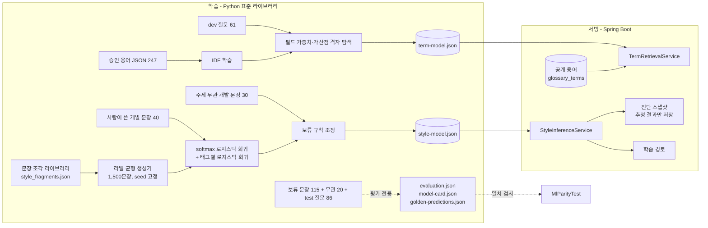

# 18. AI·학습 모델 설계와 데이터 거버넌스

> 작성일: 2026-10-16
> 관련: [14-ai-service-integration.md](14-ai-service-integration.md)(LLM 설명 경로), [ml/README.md](../ml/README.md)(재현 방법·전체 지표), ADR-008·013~016

FinMATE의 AI는 세 층으로 나뉜다. **판정은 규칙, 설명은 LLM, 보조 신호는 직접 학습한 모델**이다. 이 문서는 세 번째 층(직접 학습한 두 모델)을 중심으로 어디에 쓰고 어디에 쓰지 않는지, 데이터를 어떻게 만들고 지키는지 정리한다.

## 1. AI가 하는 일과 하지 않는 일

| 기능 | 담당 | AI가 결과를 바꿀 수 있나 |
|---|---|---|
| 성향 점수·5단계 등급·탐색 카테고리 | 규칙 엔진(`ProfileClassifier`, `SuitabilityMatcher`) | **아니오** |
| 진단 근거 문장, 개념 질문 답변 | LLM(Claude) + 출력 검증 + 템플릿 폴백 | 문장만 |
| 자유 서술 → 성향 신호·관심사 태그 | 학습 모델 `style-signal` | **아니오**(확인 플래그·학습 추천만) |
| 질문 → 관련 용어 | 학습 모델 `term-retrieval` | 검색 순위만 |
| 다음 학습 순서 | 결정적 규칙(`LearningPathService`) | 모델 태그를 입력으로 사용 |
| 시뮬레이션 숫자 | 결정적 계산 엔진 | **아니오** |

모델 출력이 금융 판단으로 읽히지 않도록 모든 응답에 "교육용 보조 신호이며 등급·적합성 판정을 바꾸지 않는다"는 고지를 붙인다.

## 2. 전체 흐름

- 사용자 요청 때 Python을 실행하지 않는다. 모델은 JSON으로 내보내 서버가 기동 시 한 번 읽는다.
- Java 추론은 Python과 **같은 정규화·n그램·가중치 계산**을 구현하고, `MlParityTest`가 보류 문장 115개와 평가 질문 86개 각각에 대해 Python이 저장한 정답(라벨·확신도·태그·순위·점수)과 일치하는지 검사한다. 한쪽만 바뀌면 빌드가 깨진다.

## 3. 데이터

| 데이터 | 개수 | 출처 | 용도 | 학습 사용 |
|---|---:|---|---|---|
| 생성 문장(`style_fragments.json` → 생성기) | 1,500 | 설문 축 문장 조각 조합, 라벨은 조각 점수 가중 평균 | 성향·태그 학습 | ✅ |
| 개발 문장(`style_dev.jsonl`) | 40 | 사람이 작성 | 하이퍼파라미터 선택 + 최종 학습(가중치 3) | ✅ |
| 주제 무관 개발 문장(`style_offtopic_dev.jsonl`) | 30 | 사람이 작성 | 보류 규칙 조정 | 조정만 |
| 보류 문장(`style_holdout.jsonl`) | 115 | 사람이 작성(라벨 균형 23×5, 태그 라벨 포함) | 최종 평가 | ❌ |
| 주제 무관 보류 문장 | 20 | 사람이 작성 | 보류 규칙 평가 | ❌ |
| 승인 용어(`glossary/terms/*.json`) | 247 | 공식 기관 자료를 근거로 작성, 출처 필수 | IDF | ✅ |
| 용어 질문(`term_queries.jsonl`) | 147 | 사람이 작성(dev 61 / test 86) | 가중치 탐색 / 평가 | dev만 |

**누수 방지** 개발·보류 문장 사이에 같은 문장이 있으면 학습이 실패하고, 보류 문장과 학습 재료(조각·개발 문장)의 문자 4그램 자카드 유사도 최댓값(현재 0.26)이 0.5 미만인지 테스트한다. 생성기 조각이 보류 문장과 비슷해진 사례 3건은 조각 쪽 표현을 바꿔 해소했다(보류 문장은 수정하지 않음).

**실제 사용자 데이터는 쓰지 않았다.** 진단 화면의 자유 서술 원문은 저장하지 않으므로 학습 데이터로 쌓이지도 않는다. 실제 문장으로 재평가하려면 별도 동의 절차가 필요하다(§7).

## 4. 모델 카드 요약

전체 수치·혼동행렬·오답 목록은 `ml/reports/evaluation.json`, 화면에서는 `/models`의 모델 카드(`GET /api/ml/models`)로 볼 수 있다.

### style-signal v2.0.0 — 자유 서술 투자 성향 신호

| 항목 | 내용 |
|---|---|
| 과업 | 투자 생각 문장 → 5단계 성향 확률 + 관심사 태그 9종 |
| 알고리즘 | 문자 2~4그램(`1+log tf`, L2) softmax 로지스틱 회귀(epoch 5, L2 0.003), 태그별 로지스틱 회귀, 온도 0.4 |
| 보류 규칙 | 근거 조각(|w| ≥ 0.3) 6개 미만 또는 확신도 < 0.3이면 INSUFFICIENT |
| 불일치 규칙 | 설문 등급과 2단계 이상 차이 + 확신도 ≥ 0.5 |
| 보류 115문장 | 정확도 **0.617**, macro F1 0.629, ±1등급 **0.904**, 판단 비율 0.965, ECE 0.044 |
| 주제 무관 20문장 | 보류율 **1.00** |
| 태그 | micro P/R/F1 = 0.651 / 0.471 / 0.547 |
| 기준선 | 최빈 0.200, 키워드 규칙 0.417, v1 나이브 베이즈(40문장) 0.522 |
| 쓰는 곳 | 진단 확인 플래그, 결과 화면 신호 카드, 학습 경로, 모델 실험실 |
| 쓰지 않는 곳 | 등급 판정, 적합성·적정성 판단, 상품 안내 범위 결정 |

### term-retrieval v2.0.0 — 질문형 용어 검색

| 항목 | 내용 |
|---|---|
| 과업 | 질문 → 관련 공개 용어 순위 |
| 알고리즘 | 필드(이름·정의·본문)별 문자 2~4그램 TF-IDF 코사인 가중합(1.5 · 1.5 · 1.0) + 용어명 일치 0.2, 별칭만 일치 0.1 |
| test 86질문 | Top-1 **0.860**, Top-5 **0.988**, MRR 0.912 |
| 설명형(용어명 없음) 53질문 | Top-1 **0.792**, Top-5 0.981 |
| 기준선 | v1(필드를 이어 붙인 단일 문서) 전체 Top-1 0.628, 설명형 0.415 |
| 운영 | 문서 벡터는 DB 공개 용어로 구성, 게시·공개 내리기 이벤트(커밋 후)로 재구성. IDF에 없는 조각은 IDF 최댓값 |

## 5. 개인정보·안전 설계

| 원칙 | 구현 |
|---|---|
| 원문 최소 수집 | 자유 서술은 추정에만 쓰고 버린다. 스냅샷에는 상태·성향·확신도·태그·모델 버전만 저장(통합 테스트가 원문 부재를 확인) |
| 월권 금지 | 모델은 규칙 엔진이 등급을 확정한 **뒤** 호출된다. 결과는 플래그·추천에만 쓰인다 |
| 모를 때는 모른다 | 근거 부족·주제 무관 문장은 판단을 보류한다 |
| 재현성 | seed 고정 생성·학습, 모델 버전을 스냅샷에 저장, 같은 모델이면 같은 입력에 같은 출력 |
| 투명성 | 학습 데이터 구성·지표·기준선·한계를 모델 카드로 공개 |
| 실패 시 안전 | 모델 산출물이 없거나 깨지면 서버가 기동하지 않는다(조용한 오동작 방지) |
| 표현 통제 | LLM 출력은 금칙어(매수·매도·추천·보장·수익률 예측)·길이 검사 후 위반 시 템플릿으로 대체(docs/14) |

## 6. 재학습·배포 절차

1. 데이터 또는 용어 JSON을 수정한다(용어 JSON 변경 시 `term-model.json`의 `sourceSha256`이 달라져 Python 테스트가 재학습을 요구한다).
2. `make model` (= `python3 ml/train.py`)로 학습·평가·내보내기를 한다. 약 20초, seed 고정.
3. `make test`로 Python 회귀 테스트(기준선 대비 성능·누수·결정성·정답 재현)와 Java 테스트(`MlParityTest` 포함)를 통과시킨다.
4. `ml/reports/evaluation.json`의 변화(특히 보류 정확도·주제 무관 보류율·설명형 Top-1)를 커밋 메시지에 남기고 배포한다.

관리자가 용어를 게시하는 것만으로는 재학습이 필요 없다. 다만 새 용어가 많이 쌓이면 IDF가 근사값이 되므로 주기적으로 재학습한다.

## 7. 알려진 한계와 다음 단계

| 한계 | 영향 | 다음 단계 |
|---|---|---|
| 성향 모델의 학습 문장 대부분이 생성 문장 | 실제 사용자 표현에서 정확도가 다를 수 있음 | 동의 기반 수집(원문은 별도 저장소, 보존 기한·삭제 경로 명시) 후 재평가 |
| 보류 문장 작성자가 1명 | 문체 다양성 부족 | 복수 작성자·실사용 문장으로 평가셋 확장 |
| 이웃 등급 간 혼동(위험중립↔안정추구 등) | 정확도 0.62 | 불일치 판단을 2단계 이상 차이로 한정해 영향 완화, 서술형 문항 설계 개선 |
| 반어·부정 표현 | 오분류 | 문맥 특징(어절 n그램) 추가 실험 |
| 짧은 잡담 일부 분류(주제 무관 개발 문장 30개 중 3개) | 불필요한 신호 | 보류 규칙에 주제 판별기 추가 |
| 문자 조각 기반 검색 | 전혀 다른 어휘의 질문을 놓침 | 한국어 문장 임베딩 + 하이브리드 검색 비교(오프라인 평가 후 도입) |
