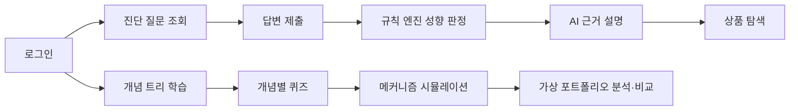
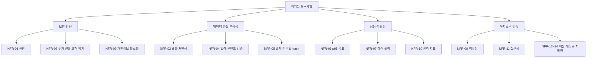

# FinMATE 발표용 API·요구사항 시각화 SOP

> 목적: API 명세, Use Case Diagram, 기능/비기능 요구사항을 캡처하고 발표 슬라이드에 연결하는 작업 순서  
> 기준 파일: `presentation/FinMATE-발표용-API.yml`, `docs/07-usecase.puml`, `docs/13-functional-nonfunctional-usecases.md`

## 0. 먼저 준비할 파일

작업 시작 전에 다음 파일이 실제로 존재하는지 확인한다.

| 파일 | 용도 |
|---|---|
| `presentation/FinMATE-발표용-API.yml` | Swagger Editor에 불러올 발표용 OpenAPI 명세 |
| `presentation/FinMATE-API-발표요약.md` | 슬라이드에 옮겨 적을 API 표와 대표 요청/응답 |
| `docs/07-usecase.puml` | Use Case Diagram 원본 |
| `docs/13-functional-nonfunctional-usecases.md` | FR/NFR/UC 추적 기준 |
| `presentation/FinMATE-발표자료.pptx` | 최종 발표 파일 |

현재 발표용 API 명세는 **25개 path, 26개 operation**이다. 실데이터 수집·과거 자료·관리자 검수 API는 P1 확장으로 표시한다.

## 1. API 명세를 시각화하는 방법

### 1-1. 가장 빠른 방법: Swagger Editor

1. 브라우저에서 [Swagger Editor](https://editor.swagger.io/)를 연다.
2. 왼쪽 편집 영역의 기존 내용을 모두 선택한다.
3. `presentation/FinMATE-발표용-API.yml`의 전체 내용을 붙여 넣는다.
4. 오른쪽 문서 화면에서 제목이 `FinMATE 학습형 금융상품 탐색 API`인지 확인한다.
5. `Authorize` 버튼을 누르지 않아도 된다. 발표에서는 계약·흐름을 보여 주는 것이 목적이며 실제 호출은 선택 사항이다.
6. 오른쪽 화면에서 아래 세 영역만 펼친다.
   - `auth`, `questions`, `assessments`, `products`
   - `learning`
   - `practice`
7. 브라우저 확대율을 80~90%로 조정하고, 왼쪽 YAML 편집 영역은 접거나 폭을 줄인다.
8. 화면 캡처 도구로 아래 세 장을 순서대로 저장한다.

| 파일명 | 캡처 화면 | 발표 역할 |
|---|---|---|
| `presentation/captures/01-api-overview.png` | API 제목, 서버 URL, 태그 목록, 25 paths/26 operations가 보이는 상단 | API 전체 구조 소개 |
| `presentation/captures/02-api-assessment.png` | `POST /assessments`, `GET /assessments/{assessmentId}`, `GET .../recommendations` | 진단 결과가 API로 연결되는 과정 |
| `presentation/captures/03-api-learning-practice.png` | `/learning/*`, `/practice/*`가 보이는 영역 | 학습·시뮬레이션·모의 포트폴리오 고도화 |

캡처할 때 브라우저 주소창, 개인 계정, 토큰, 불필요한 YAML 원문은 보이지 않게 한다. 명세가 길어 한 화면에 모든 경로가 보이지 않으면 같은 태그 단위로 나누어 캡처한다.

### 1-2. 로컬 Swagger UI를 사용하는 방법

발표 직전에 인터넷 접속이 불안정하면 로컬 Swagger UI를 사용한다.

1. 백엔드를 실행한다.
2. Swagger UI가 연결된 경우 `http://localhost:8080/swagger-ui/index.html`을 연다.
3. 연결된 명세가 현재 YAML과 다르면 Swagger UI의 URL 입력 기능에서 `presentation/FinMATE-발표용-API.yml`을 선택한다.
4. `Try it out`은 실제 호출을 보여 줄 때만 사용한다.
5. 호출 화면을 캡처할 때는 실제 사용자 이메일, 토큰, 개인 정보가 없는 seed 데이터만 사용한다.

Swagger UI가 프로젝트에 연결되어 있지 않다면 Swagger Editor 캡처를 사용한다. 발표용 시각화에는 실제 서버 실행 여부보다 API 계약과 흐름이 중요하다.

## 2. API 캡처를 발표와 연결하는 방법

슬라이드에 캡처를 많이 넣지 말고, 한 장마다 하나의 질문에 답하게 한다.

| 발표 슬라이드 | 넣을 자료 | 발표 문장 |
|---|---|---|
| 문제·해결 구조 | `01-api-overview.png` 일부 | “진단만 하는 서비스가 아니라 학습과 실험까지 API로 분리했습니다.” |
| 핵심 기능 흐름 | `02-api-assessment.png` | “답변은 규칙 엔진이 판정하고, AI는 근거 설명만 생성합니다.” |
| 고도화 결과 | `03-api-learning-practice.png` | “등급 때문에 거래하지 못하는 사용자도 개념을 배우고 가정값으로 실험할 수 있습니다.” |
| 안전장치 | API 요약의 `reasoningSource`, `limitations`, `disclaimer` | “예측·추천·주문이 아니라 가정과 한계를 함께 반환합니다.” |
| 확장 계획 | `docs/13...`의 P1 표 | “실데이터 수집과 과거 자료는 출처·기준일·hash를 저장하는 P1로 확장합니다.” |

### API 화면을 슬라이드에 넣는 배치

1. 왼쪽 60%: Swagger 캡처
2. 오른쪽 40%: 세 문장만 작성
   - 입력: 무엇을 받는가?
   - 처리: 규칙 엔진/계산 엔진/AI 중 누가 처리하는가?
   - 출력: 사용자가 무엇을 이해하는가?
3. 화면 하단: `교육용 정보 제공 / 실제 주문·투자자문 아님` 고지를 고정한다.

## 3. Use Case Diagram을 만드는 방법

### 3-1. 기준 원본

최신 원본은 `docs/07-usecase.puml`이다. 다이어그램에 다음 액터가 있어야 한다.

- 일반 사용자
- 운영자/콘텐츠 검수자
- 규칙 엔진
- AI 설명 생성기
- 외부 데이터 공급자
- 인증·관측 인프라

### 3-2. 렌더링 및 캡처

#### 방법 A: PlantUML 확장 사용

1. VS Code에 PlantUML 확장을 설치한다.
2. `docs/07-usecase.puml`을 연다.
3. `Alt + D` 또는 확장의 Preview 기능으로 미리 본다.
4. 다이어그램이 잘리면 미리보기 확대율을 줄이고, P0 패키지와 P1 패키지가 모두 보이는 상태로 맞춘다.
5. PNG 또는 SVG로 내보내 `presentation/captures/04-usecase.png`로 저장한다.

#### 방법 B: PlantUML 웹 편집기 사용

1. PlantUML을 지원하는 웹 편집기를 연다.
2. `docs/07-usecase.puml` 전체를 붙여 넣는다.
3. 미리보기에서 제목, 액터, P0/P1 패키지, `<<include>>` 관계가 모두 보이는지 확인한다.
4. PNG로 저장한다.

### 3-3. 발표에서 설명하는 순서

1. 일반 사용자가 진단·학습·실험을 시작한다.
2. 답변 제출은 규칙 엔진 판정과 AI 설명 생성을 포함한다.
3. 학습과 모의투자는 진단 등급과 별도 흐름이다.
4. 운영자는 실데이터와 콘텐츠를 검수한 뒤 게시한다.
5. 실제 주문·계좌 연동은 다이어그램에 넣지 않고 제외 범위로 말한다.

`<<include>>`는 반드시 수행되는 하위 동작에만 사용한다.

- `답변 제출` → `성향·탐색 범위 판정`
- `답변 제출` → `근거 생성·폴백`
- `개념 학습` → `방법론·가정·기준시각 확인`
- `포트폴리오 실험` → `전후 결과 비교`

일반 사용자와 유스케이스 연결선에는 화살표를 붙이지 않는다. 화살표는 `include`와 `extend` 관계에만 사용한다.

## 4. 기능 요구사항과 비기능 요구사항을 나눠 그리는 방법

### 4-1. 기능 요구사항(FR) 작성 규칙

기능 요구사항은 “누가 무엇을 할 수 있는가”로 작성한다.

```text
[액터] + [동작] + [결과]
일반 사용자가 개념별 퀴즈를 제출하면 서버가 정답과 오답 해설을 반환한다.
```

현재 발표에서 보여 줄 P0 기능은 다음 순서다.



발표용 FR 목록은 `docs/13-functional-nonfunctional-usecases.md`의 FR-01~FR-20을 사용한다. 슬라이드에는 모든 항목을 넣지 말고 다음 8개를 대표로 표시한다.

| 대표 FR | 발표 표현 |
|---|---|
| FR-01 | 회원가입·로그인 |
| FR-04 | 답변 제출·진단 생성 |
| FR-05 | 규칙 기반 성향 판정 |
| FR-06 | AI 근거 설명·템플릿 폴백 |
| FR-08 | 카테고리·상품 탐색 |
| FR-10 | 개념 트리·그림·출처 학습 |
| FR-11 | 개념별 퀴즈·오답 교정 |
| FR-13 | 교육용 포트폴리오 실험·비교 |

### 4-2. 비기능 요구사항(NFR) 작성 규칙

비기능 요구사항은 기능이 아니라 품질·제약·운영 조건이다. “빠르다”, “안전하다”라고만 쓰지 말고 측정 방법을 붙인다.

```text
나쁜 예: API가 빨라야 한다.
좋은 예: 일반 조회 API의 p95 응답 시간을 1초 이내로 유지하고 부하 테스트로 검증한다.
```

발표에서는 NFR을 4개 그룹으로 묶어 그린다.



NFR은 Use Case Diagram 안에 전부 넣지 않는다. Use Case Diagram은 사용자의 목적과 시스템 상호작용을 보여 주고, NFR은 별도 품질 표·검증 기준·아키텍처 주석으로 연결한다.

## 5. 발표자료에 넣는 최종 순서

### 슬라이드 1: 문제와 사용자

- 성향 결과 때문에 원하는 상품을 공부하기 어려운 문제
- 상품 이름보다 메커니즘과 위험 변수를 배워야 한다는 해결 방향

### 슬라이드 2: 서비스 범위

- 진단·상품 탐색
- 주식·채권·펀드·ETF·부동산·금·선물·옵션·마진·레버리지 학습
- 교육용 시뮬레이션과 포트폴리오 실험

### 슬라이드 3: Use Case Diagram

- `04-usecase.png` 삽입
- P0와 P1을 색상 또는 패키지로 구분

### 슬라이드 4: 기능 요구사항

- 대표 FR-01, FR-04, FR-05, FR-06, FR-08, FR-10, FR-11, FR-13
- 사용자 여정 flowchart 삽입

### 슬라이드 5: API 설계

- `01-api-overview.png` 삽입
- “25 paths / 26 operations” 표시
- 태그별 API 그룹 설명

### 슬라이드 6: 진단 API 동작

- `02-api-assessment.png` 삽입
- 요청 → 규칙 판정 → AI 설명 → 결과 응답 설명

### 슬라이드 7: 학습·모의투자 고도화

- `03-api-learning-practice.png` 삽입
- 개념별 퀴즈와 시뮬레이션이 같은 개념 slug를 중심으로 연결된다는 점 설명

### 슬라이드 8: 비기능 요구사항과 안전장치

- NFR 4개 그룹 도식 삽입
- `reasoningSource`, `seed`, `modelVersion`, `limitations`, `disclaimer` 강조

### 슬라이드 9: 배포형 확장 계획

- 실데이터 수집
- 기준일·지연·원문 URL·hash 저장
- 과거 자료 탭
- 관리자 콘텐츠 검수

## 6. 최종 점검 체크리스트

### API 시각화

- [ ] YAML이 Swagger Editor에서 오류 없이 열린다.
- [ ] 제목과 서버 URL이 현재 프로젝트와 일치한다.
- [ ] `assessments`, `learning`, `practice` 태그가 보인다.
- [ ] 요청/응답 예시에 실제 DTO 필드가 사용된다.
- [ ] access token, 실제 이메일, 개인정보가 캡처에 없다.
- [ ] 각 캡처 파일의 역할이 슬라이드 한 장과 1:1로 연결된다.

### Use Case Diagram

- [ ] 일반 사용자·운영자·규칙 엔진·AI·외부 공급자가 구분된다.
- [ ] P0와 P1이 패키지로 나뉜다.
- [ ] `include`와 `extend`가 필요한 곳에만 사용된다.
- [ ] 실제 주문·계좌 연동이 범위 밖으로 표시된다.

### FR/NFR

- [ ] FR은 동작 문장으로 작성했다.
- [ ] NFR은 품질·제약·검증 방법을 포함한다.
- [ ] NFR을 Use Case와 억지로 같은 도형에 넣지 않았다.
- [ ] 모든 대표 FR은 API 또는 화면과 추적된다.
- [ ] 발표 마지막에 P1 확장 범위와 현재 미구현 범위를 구분했다.

## 7. 산출물 저장 위치

```text
presentation/
├── FinMATE-발표용-API.yml
├── FinMATE-API-발표요약.md
├── FinMATE-발표-시각화-SOP.md
└── captures/
    ├── 01-api-overview.png
    ├── 02-api-assessment.png
    ├── 03-api-learning-practice.png
    └── 04-usecase.png

docs/
├── 07-usecase.puml
├── 13-functional-nonfunctional-usecases.md
└── 04-api-design.md
```

